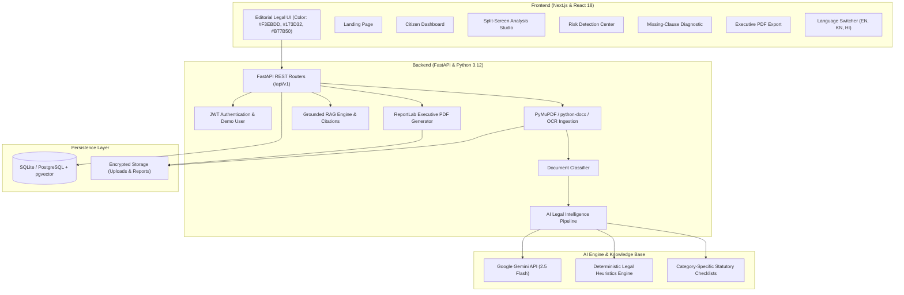

# LEXORA — AI Legal Companion

> **"Understand Your Rights. Understand Your Documents."**
> 
> *An advanced, multilingual AI document intelligence platform that simplifies complicated legal contracts, pinpoints hidden risks with supporting evidence, audits missing protective clauses against statutory checklists, and empowers citizens in English, Kannada, and Hindi.*

---

## 1. System Architecture



---

## 2. Key Features

### 🏛️ Unique Editorial Legal UI/UX Design
- **Strict Curated Palette**:
  - Primary Background: `#F3EBDD` (Paper parchment tone)
  - Primary Green: `#173D32` (Deep editorial legal green)
  - Secondary Green: `#315D49`
  - Copper Accent: `#B77B50` (Wax-seal warm copper)
  - Charcoal Body Text: `#252B29`
  - Muted Editorial Ink: `#77766E`
  - Crisp Paper Surfaces: `#FFFFFF` and `#FAF6F0`
- **Zero generic AI templates**: Strictly avoids purple-blue and neon gradients. Features classic serif headings (*Newsreader/Georgia*), crisp sans-serif body (*Inter*), thin borders, and paper deckle cards.

### 📄 Document Ingestion & Segmenter
- Accepts **PDF**, **DOCX**, **TXT**, and **Image documents (PNG/JPG)** with file validation up to 25 MB.
- Segments contracts into structured clauses, tracks page numbers, and indexes searchable text chunks.

### ⚖️ Evidence-Grounded Risk Detection Center
- Categorizes findings into **Financial Penalty**, **Termination Rights**, **Liability & Indemnity**, **Restraint of Trade / Non-Compete**, and **Privacy & Inspection**.
- Severity indicators: **High**, **Medium**, **Low**.
- Quotes verbatim text, explains the citizen impact, states the legal rationale (e.g. *Indian Contract Act Section 27* for non-competes), and suggests exact questions to ask an attorney.

### 🔍 Missing-Clause Checklist Diagnostic
- Evaluates documents against category checklists:
  - **Rental / Lease**: 24-hour advance inspection notice, security deposit refund timeline & deductions audit, major structural repair division, mutual termination notice, and force majeure.
  - **Employment & Bonds**: Clear probation duration and written confirmation, personal IP carve-out, standard working hours & overtime, and PoSH Act grievance redressal.
  - **Non-Disclosure Agreements (NDA)**: Standard public domain/subpoena exceptions, sunset expiry term (2-3 years), and return/destruction protocols.
  - **Consumer Loan Agreements**: Transparent APR & fee disclosure, prepayment/foreclosure penalty caps, and default grace/cure periods.
  - **General Contracts**: Mutual termination notice, limitation of liability caps, and governing law/dispute venue.
- Distinguishes **Statutory Mandatory Protections** from **Commercial Recommendations**.
- Provides copy-pasteable recommended standard boilerplate clauses to negotiate into the agreement.

### 🌐 Multilingual Equality (English, Kannada, Hindi)
- Instant 1-click language switching between **English**, **Kannada (ಕನ್ನಡ)**, and **Hindi (हिन्दी)**.
- Simplifies complex clauses into native regional terms without losing legal precision.

### 💬 Grounded Conversational RAG Assistant
- Answers citizen queries strictly using document excerpts.
- Displays clickable citations with page numbers that jump directly to and highlight the corresponding clause in the original document viewer.
- Never hallucinates non-existent laws or clauses.

### 📊 Downloadable Executive PDF Legal Brief
- Generates a PDF report via ReportLab formatted with the LEXORA editorial design, tabular breakdown of obligations, risk matrix, and attorney consultation checklist.

### 🧪 Pre-Packaged Synthetic Demonstration Documents
1. **Residential Tenancy Agreement (Bengaluru)**: Harsh 11-month lock-in, total deposit forfeiture, unrestricted landlord entry, and 24% late penalty interest.
2. **Tech Employment Agreement & Service Bond**: Mandatory 3-year bond with ₹5 Lakh liquidated damages penalty, 2-year post-termination non-compete, and 24/7 on-call availability.
3. **Mutual Non-Disclosure Agreement**: Perpetual confidentiality, missing public domain exclusions, and absence of dispute resolution venue.

---

## 3. Technology Stack

- **Frontend**: Next.js 14 (App Router), React 18, TypeScript, Tailwind CSS, Lucide React icons, Framer Motion.
- **Backend**: FastAPI, Python 3.12, Pydantic v2, SQLAlchemy, Uvicorn.
- **Document Processing**: PyMuPDF (`fitz`), `python-docx`, Pillow.
- **AI & RAG**: Google Gemini API (`gemini-2.5-flash`), custom TF-IDF grounded vector retrieval, deterministic legal heuristics engine.
- **Reports**: ReportLab PDF Generation engine.
- **Database**: SQLite (default zero-config) / PostgreSQL with `pgvector` compatibility.

---

## 4. Quick Start & Execution

### Option A: 1-Click Launch (Windows)
Double-click `run_lexora.bat` or run:
```powershell
.\run_lexora.ps1
```

### Option B: Manual Startup

#### 1. Backend Setup
```powershell
# Create and activate Python virtual environment
py -3.12 -m venv venv
.\venv\Scripts\Activate.ps1

# Install dependencies
pip install -r backend\requirements.txt

# Run unit & API tests
$env:PYTHONPATH="backend"
pytest backend\tests\test_backend.py -v

# Launch Backend API server
uvicorn app.main:app --host 127.0.0.1 --port 8000 --reload
```
- API Documentation (Swagger): [http://127.0.0.1:8000/docs](http://127.0.0.1:8000/docs)
- Health Check: [http://127.0.0.1:8000/health](http://127.0.0.1:8000/health)

#### 2. Frontend Setup
```powershell
cd frontend
npm install
npm run dev
```
- Open Web Application: [http://localhost:3000](http://localhost:3000)

---

## 5. Docker Deployment

```bash
docker compose up --build
```
- Frontend: `http://localhost:3000`
- Backend API: `http://localhost:8000`

---

## 6. Legal Safety & Disclaimer

> **IMPORTANT NOTICE:** LEXORA is an educational legal information assistant developed to demystify complex contract language for citizens. LEXORA does not provide formal legal advice, establish attorney-client privilege, or make binding determinations on statutory validity. Citizens should always consult an authorized legal advocate or attorney before signing binding agreements.
